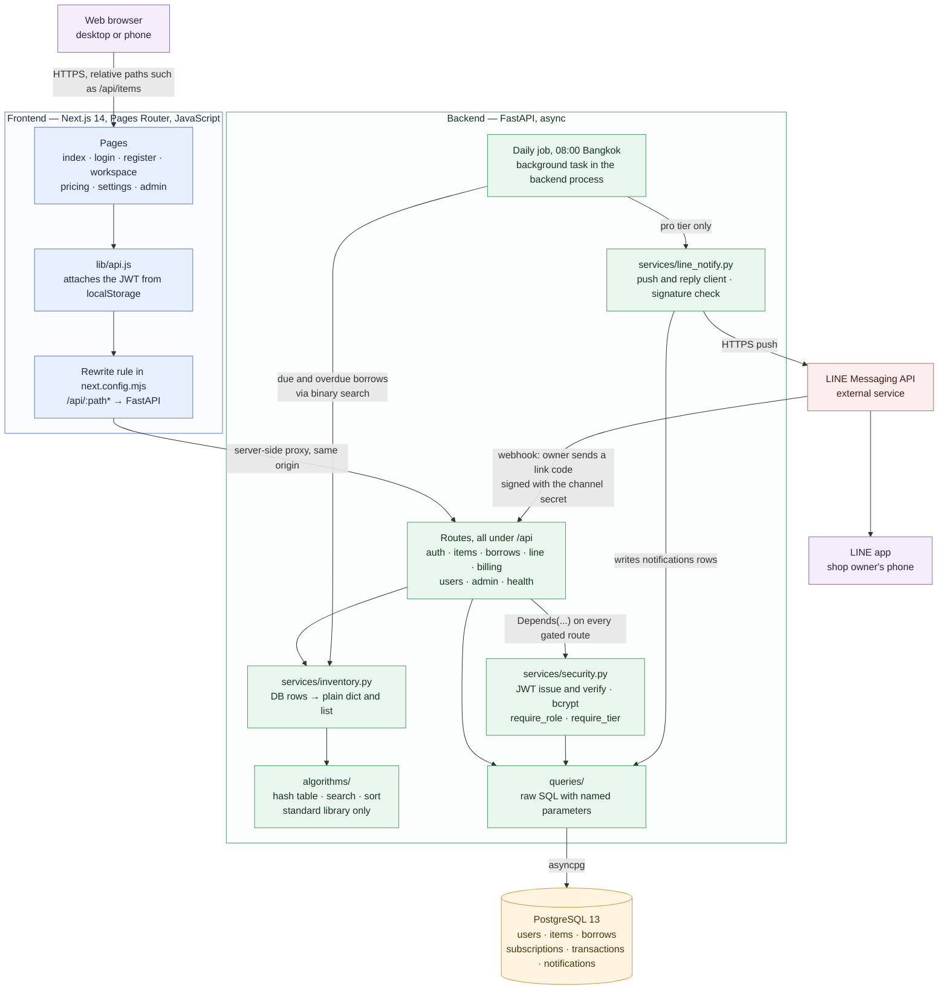
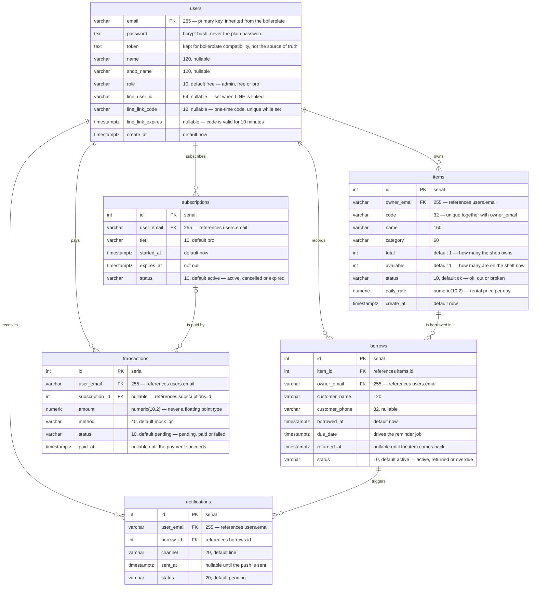

# LEBIS — Architecture

Source of truth for both diagrams:

- System architecture: `docker-compose.yaml`, `nextjs/next.config.mjs`, `backend-api/app.py`
- ER diagram: `setup_db()` in `backend-api/database.py`, verified against the running
  PostgreSQL instance

Both diagrams are written in Mermaid. Export instructions are at the end of this file.

---

## 1. System Architecture



### Where each component runs

| Component | Local development | Deployed |
|---|---|---|
| Next.js frontend | Docker container, port 3000 | Vercel |
| FastAPI backend | Docker container, port 8000 | Railway or Render |
| PostgreSQL | Docker container, host port 5433 mapped to 5432 | Managed PostgreSQL on the same platform as the backend |
| Daily reminder job | Background task inside the backend process, 08:00 Bangkok time | Same — no separate scheduler service |
| LINE Messaging API | Same external service in both cases | Same external service in both cases |

### Notes

The browser never calls the backend directly. Pages call relative paths such as
`/api/items`, and Next.js rewrites `/api/:path*` to the FastAPI service. Requests
therefore leave the browser on a single origin, so the project needs no CORS
configuration and no public API URL.

`lib/api.js` is the only place that reads the JWT and sets the `Authorization`
header. Pages call it instead of `fetch` directly.

Authorization is enforced in FastAPI dependencies, not in route bodies and not in
the frontend. `require_role` and `require_tier` return 403 when the caller lacks
the role or the subscription tier. Hiding a button in the frontend is not
enforcement, because the API can be called directly.

Files under `algorithms/` import nothing outside the Python standard library. The
adapter that converts database rows into plain dictionaries and lists lives in
`services/inventory.py`. This keeps each algorithm file runnable on its own in a
Google Colab notebook.

The daily job sends one message per shop per day, not one per borrow. It finds
borrows that are overdue, due today or due tomorrow through `services/inventory.py`,
which runs the hand-written binary search from `algorithms/search.py`. It then
pushes a single summary to the shop owner's LINE and writes one `notifications` row
per borrow in that summary. Reminders are available to Pro accounts only.

One message per shop is a quota decision. A free LINE Official Account in Thailand
can push 300 messages a month; reply messages are free. A daily summary costs about
30 messages per shop per month. One message per borrow would exhaust the quota for
a single busy shop.

A shop links its LINE account without typing any LINE ID. The settings page asks
for a one-time 8-character code, valid for 10 minutes. The owner sends that code to
the LEBIS Official Account in the LINE app, LINE forwards it to `/api/line/webhook`,
and the backend verifies the request signature before linking the account. The
confirmation is sent as a reply, which does not count against the quota.

The job cannot send the same summary twice. It skips shops that already have a
`sent` row for today, and every push carries a retry key derived from the shop and
the date, so the LINE platform itself discards a duplicate within 24 hours. This
matters when the backend restarts after 08:00 and runs the job again.

In local development all three services are defined in one `docker-compose.yaml`
and start together. Inside the Compose network they reach PostgreSQL at `db:5432`.
The host port is 5433 because port 5432 is already taken on the development
machine.

---

## 2. ER Diagram



### Notes

`users.email` is the primary key. The boilerplate created the table that way, and
keeping it means the existing authentication code and the demo account continue to
work. Every other table references a user by email rather than by a numeric id.

`items` has a composite unique key on `(owner_email, code)`. Item codes are unique
within one shop, not across the whole database, so two shops can both use the code
`CAM-01`.

One `borrows` row is one item held by one customer. `available` on `items` is the
count that is still on the shelf; `total` is the count the shop owns. The
difference is the number of active borrows.

`returned_at` stays null while the item is out. `status` carries the same
information in a form that is cheap to filter on, and `due_date` is the column the
reminder job scans.

`transactions.subscription_id` is nullable, so a payment attempt can be recorded
before a subscription row exists. A failed payment therefore leaves a transaction
row with no subscription attached.

Money is stored as `NUMERIC(10,2)`, never as a floating point type.

`notifications` links a user and a borrow, so a reminder can always be traced back
to the item and the due date that produced it.

---

## Exporting the diagrams as PNG for the PDF

### Option 1 — Mermaid CLI, one command for both diagrams

```bash
npx -y @mermaid-js/mermaid-cli -i docs/architecture.md -o docs/architecture.png -b white -s 3
```

Each diagram in the file becomes a separate image: `docs/architecture-1.png` for the
system architecture and `docs/architecture-2.png` for the ER diagram. `-b white`
sets a white background, which matters because the default is transparent and the
lines disappear on a white PDF page. `-s 3` renders at three times the size so the
labels stay readable in print.

The first run may download a headless browser. The command does not modify
`architecture.md`; it only writes the image files.

### Option 2 — mermaid.live, no installation

Open <https://mermaid.live>, paste the contents of one mermaid code block, then use
**Actions → PNG**. Set the scale to 3x before exporting. Repeat for the second
diagram.

### Option 3 — VS Code

Install the *Markdown Preview Mermaid Support* extension, open this file, and open
the preview with `Cmd+Shift+V`. Right-click a rendered diagram and choose
**Copy Image**, then paste it into the document.

Exported PNG files are build output. Keep them out of git unless the Design
Document is assembled from the repository.
