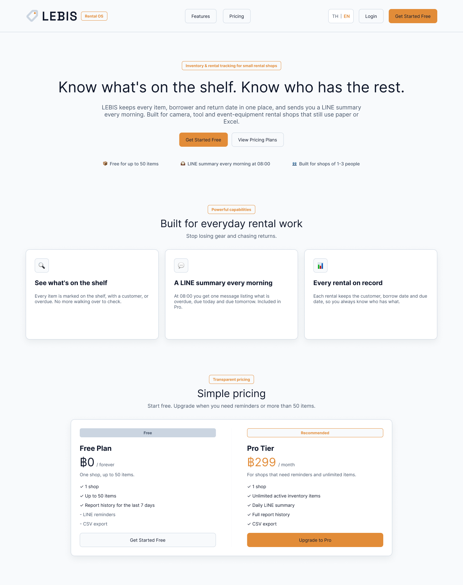
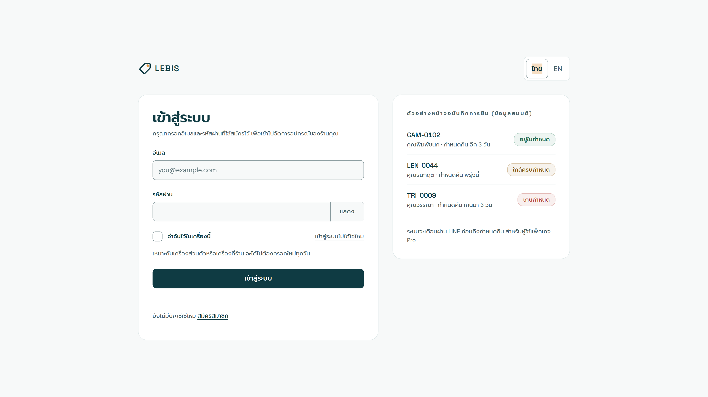
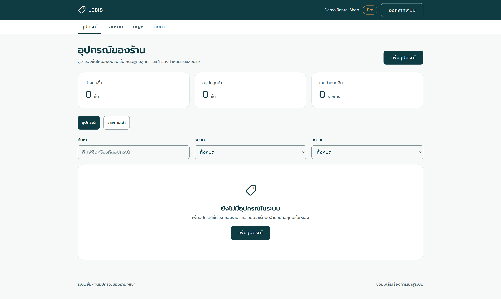
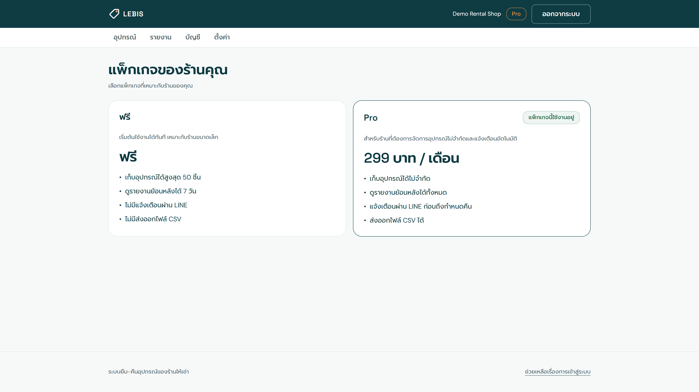
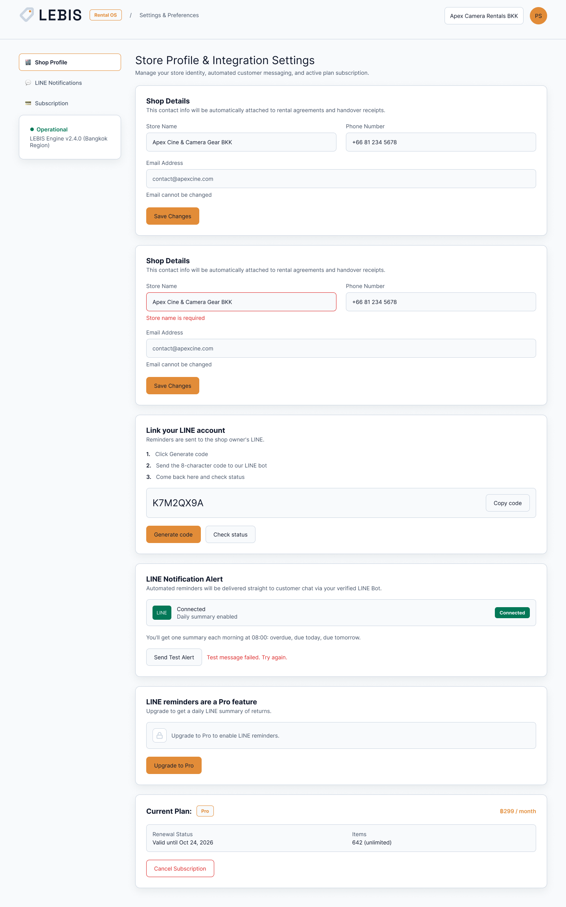
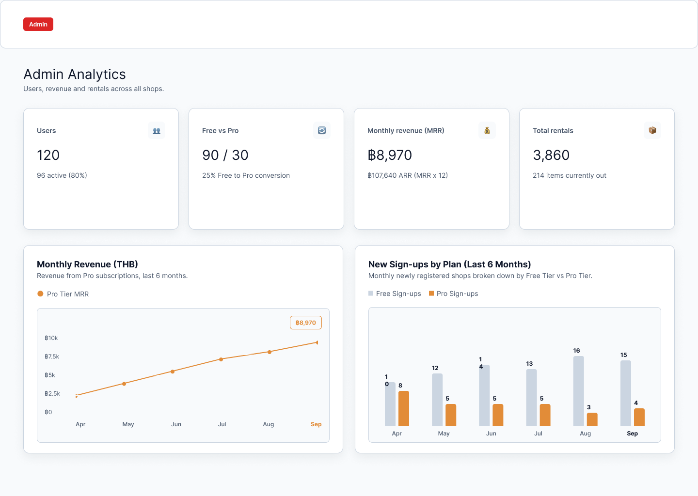
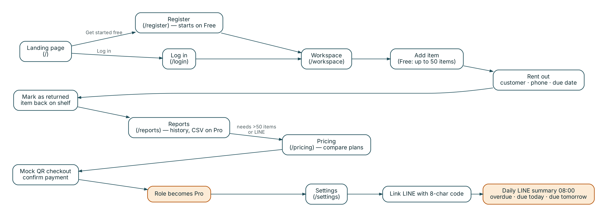

# 3. UI/UX Design

LEBIS is used by owners and staff of small rental shops (1–3 people), often on a phone at the shop counter while a customer is waiting. The interface is designed for that situation: short tasks, large touch targets, and no screen that needs a wide desktop monitor.

## Design Principles

- **Mobile-first.** Every page is tested at 320 px and 390 px wide as well as on desktop, and no page may scroll sideways. Buttons, inputs and menu items are at least 44 px tall. These rules are checked automatically by `npm run check:pages`, which opens each page in a real browser at mobile and desktop sizes.
- **Brand and color.** The visual rules come from `docs/brand.md`: a dark teal ink color for primary buttons and the header, amber used as an accent at most once per screen, and cards with a 1 px border and no shadow. Colors are CSS variables, so every page supports light and dark mode.
- **Shared components.** All pages use the same `Button`, `Card`, `FormError` and `AppShell` components, so the pages look consistent and a design change is made in one place.
- **Bilingual.** All text is stored in `lib/i18n.js` in Thai and English. The chosen language is saved in a cookie, so pages load in the right language from the start.
- **Clear feedback.** Success is shown as a short toast. Errors are shown inside the page next to the action that failed, with a "Try again" option. Actions that are hard to undo, such as cancelling the Pro plan, ask for confirmation and state the consequence.

## 3.1 Wireframes

The wireframes were designed in Figma at desktop (1440 px) and mobile (390 px) widths. Numbers shown in the wireframes are sample data.

### Public Landing Page

Explains what LEBIS does (see what is on the shelf, a LINE summary every morning, a record of every rental) and compares the Free and Pro plans, with "Get started free" as the main action.

### Authentication Page

Sign up and log in with email and password. "Remember me on this device" keeps a shop owner signed in for 30 days on the shop's own computer.

### Main Application Workspace

The page a shop uses all day: add and edit items, rent an item out to a customer with a due date, and mark it as returned. Each item shows whether it is on the shelf, with a customer, or overdue.

### Pricing & Checkout Page

Compares the Free and Pro plans and runs the simulated payment: the user confirms a mock QR checkout and their role changes to Pro.

### User Profile & Account Settings

Account management is split across two pages:

- **Account** (`/account`): edit name and shop name, choose the language, and see what the current plan includes.
- **Settings** (`/settings`): link a LINE account with an 8-character code, check the link status and send a test message (Pro only; Free users see an upgrade button), and see the current plan with its expiry date and a cancel button.

The wireframe above was an early exploration with more sections than were built. The implemented Settings page contains only the LINE and plan sections described here.

### Admin Analytics Dashboard

Four stat cards and two charts summarise the whole system for the admin. Section 7 explains how each number is calculated.

## 3.2 User Flow Diagram

1. **Landing page**: the visitor learns what LEBIS does and chooses "Get started free" (new user) or "Log in" (returning user).
2. **Register**: the new account starts on the Free plan (up to 50 items).
3. **Workspace**: the owner adds their equipment.
4. **Rent out**: each rental records the customer, phone number and due date, and the item is no longer counted as available.
5. **Return**: marking the rental as returned puts the item back on the shelf.
6. **Reports**: the owner reviews rental history (last 7 days on Free; full history and CSV export on Pro).
7. **Pricing**: when the shop needs more than 50 items or LINE reminders, the owner compares plans and completes the mock QR checkout. Their role becomes Pro.
8. **Settings**: the owner links their LINE account, and from then on receives one summary each morning at 08:00 listing items that are overdue, due today and due tomorrow.
