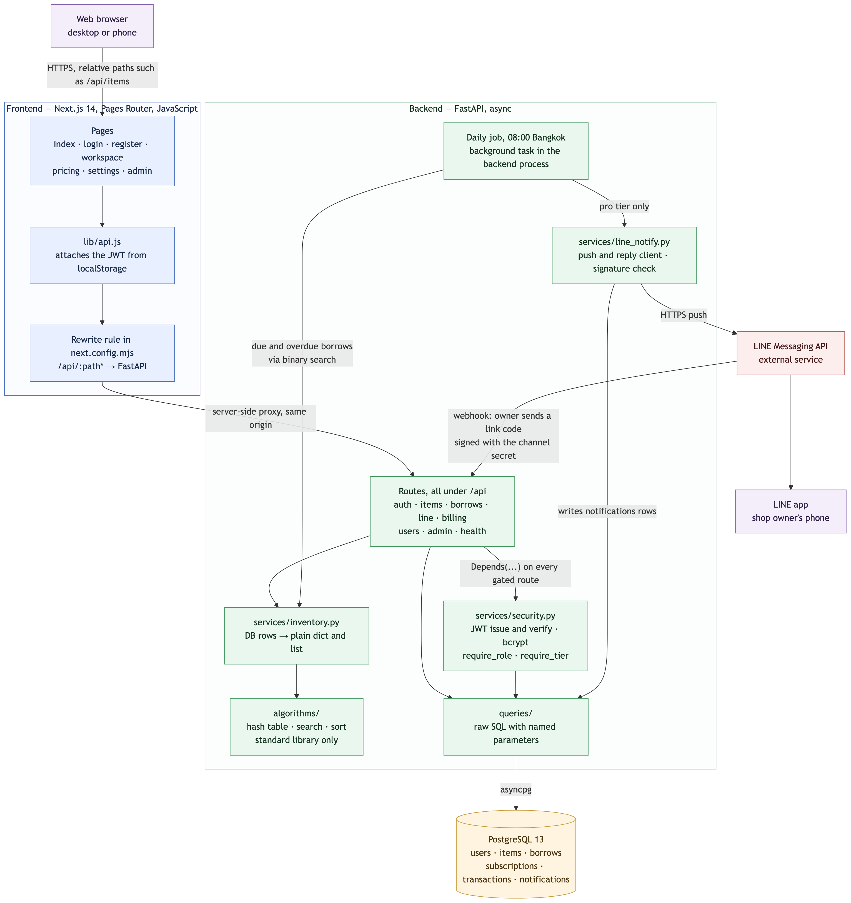
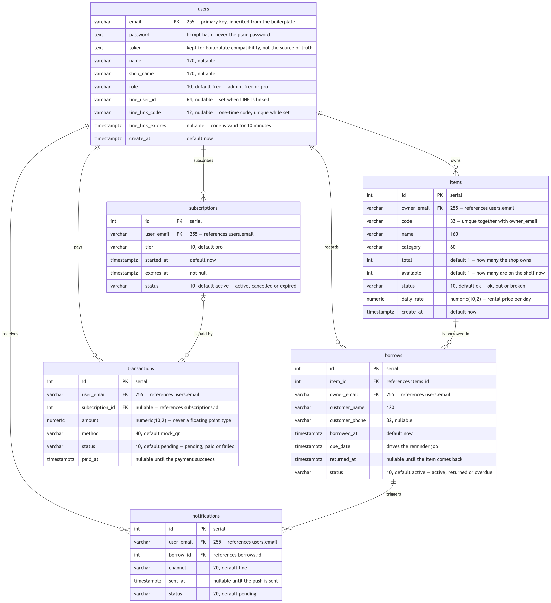

# 4. System Design

Diagram sources are in `docs/architecture.md` (Mermaid). The images below are
rendered from that file.

## 4.1 Architecture

**One origin for the browser.** Pages call relative paths such as `/api/items`.
Next.js rewrites every `/api/*` request to the FastAPI service on the server side,
so the browser only ever talks to one domain. The project needs no CORS
configuration and never exposes the backend address to the browser.

**One place that attaches the token.** `lib/api.js` is the only frontend file that
reads the JWT and sets the `Authorization` header. Pages call it instead of
`fetch`, so no page can forget to send the token.

**Authorization lives in the backend.** Every protected route declares its
requirement as a FastAPI dependency: `get_current_user` for signed-in users,
`require_tier("pro")` for paid features and `require_role("admin")` for the
admin dashboard. These return 401 or 403 before the route body runs. Hiding a
button in the frontend is never treated as protection, because the API can be
called directly.

**Every query is scoped to its shop.** Each SQL statement on items and rentals
includes `owner_email` in its `WHERE` clause. A shop that asks for another shop's
item receives **404**, not 403 — a 403 would confirm that the item exists.

**Course algorithms run inside the product.** The files in `algorithms/` import
nothing but the Python standard library, so they also run in Google Colab.
`services/inventory.py` converts database rows into the plain dictionaries those
files expect. The daily LINE reminder finds due rentals with the hand-written
binary search `find_due_before`. The same adapter provides `count_available` and
`count_overdue` for the workspace summary; on the same data they return exactly the
numbers the equivalent SQL returns.

> [Editor's note — remove before submission] Once Neo's change to
> `/api/items/summary` is merged, change the last sentence to: "The workspace
> summary counts items with `count_available` and overdue rentals with
> `count_overdue`." Until then the summary still counts with SQL.

### Where each component runs

| Component | Local development | Production |
|---|---|---|
| Next.js frontend | Docker, port 3000 | Vercel |
| FastAPI backend | Docker, port 8000 | Railway |
| PostgreSQL 13 | Docker, host port 5433 | Railway, same project as the backend |
| Daily reminder job | Background task inside the backend, 08:00 Bangkok | Same |
| LINE Messaging API | External service | External service |

## 4.2 Data model

Six tables: `users`, `items`, `borrows`, `subscriptions`, `transactions` and
`notifications`.

- **`users.email` is the primary key.** The boilerplate created the table that
  way. Keeping it means the existing sign-in code and the demo account still work.
- **Item codes are unique per shop, not globally.** `items` has a composite unique
  key on `(owner_email, code)`, so two shops can both use `CAM-01`.
- **`total` and `available` are stored separately.** `total` is how many the shop
  owns; `available` is how many are on the shelf. The difference is the number of
  active rentals. Renting and changing `total` lock the item row inside a database
  transaction, so two staff members acting at the same moment cannot push
  `available` below zero. Returning locks the rental row, so the same rental cannot
  be returned twice.
- **A due date means the end of that day in Bangkok.** A customer who must return
  an item "on 30 September" has until 23:59:59 Thai time. The database stores
  timestamps in UTC; every conversion to a calendar date uses the Bangkok time zone,
  so an item does not show as overdue at 07:00 on its due date.
- **Money is `NUMERIC(10,2)`**, never a floating-point type.
- **`notifications` has one row per rental included in a reminder**, so every
  message can be traced back to the rentals and due dates that produced it.

## 4.3 Main flows

### Sign in

1. The browser posts the email and password to `/api/auth/login`.
2. The backend loads the user and checks the password with bcrypt.
3. The backend returns a signed JWT that carries the email and an expiry time.
4. `lib/api.js` stores the token and attaches it to every later request.
5. On each request, `get_current_user` verifies the signature and expiry and loads
   the user row, including the current plan. A plan change therefore takes effect
   on the very next request.

### Rent and return

1. Staff choose an item and enter the customer name and due date.
2. `POST /api/borrows` locks the item row, checks that the item is not broken and
   that at least one unit is available, then decreases `available` by one and
   inserts the rental — all in one transaction.
3. `PUT /api/borrows/{id}/return` locks the rental row, rejects a rental that was
   already returned, sets `returned_at` and increases `available` — also in one
   transaction.

### Daily LINE reminder

1. At 08:00 Bangkok time a background task selects every Pro shop with a linked
   LINE account.
2. For each shop it finds rentals that are overdue, due today or due tomorrow,
   using the binary search from the algorithms module.
3. If there are none, nothing is sent. Otherwise the shop owner receives **one**
   message listing them, and one `notifications` row is written per rental.

The job cannot send the same summary twice in one day. It skips shops that already
have a `sent` row for today, and each push carries a retry key derived from the
shop and the date. The LINE platform discards a second request with the same key
for 24 hours. Both guards matter when the backend restarts after 08:00 and the job
runs again.

### Linking a LINE account

The owner never types a LINE user ID.

1. The settings page requests a one-time 8-character code (valid for 10 minutes).
2. The owner adds the LEBIS LINE Official Account and sends the code in the chat.
3. LINE forwards the message to `/api/line/webhook`. The backend first verifies the
   `x-line-signature` header — an HMAC-SHA256 of the raw request body keyed with the
   channel secret — and rejects the request if it does not match.
4. One SQL statement checks the code, stores the LINE user ID and deletes the code,
   so a code can be used only once.
5. The account replies with a confirmation. Replies do not count against the
   message quota.

## 4.4 Design decisions

| Decision | Reason | Alternative not taken |
|---|---|---|
| Raw SQL with named parameters, no ORM | The course boilerplate uses the `databases` library with raw SQL; named parameters prevent SQL injection | An ORM would replace the provided structure the course asks us to extend |
| Next.js rewrite instead of calling the API directly | One origin: no CORS, no public backend URL | Calling Railway from the browser would need CORS and expose the backend address |
| JWT instead of the boilerplate's stored token | The token carries its own signature and expiry, so a leaked token stops working on its own; the user row is still read on every request, so a plan change applies immediately | An opaque token stored in `users.token` would need its own expiry and revocation logic |
| One LINE message per shop per day | A free LINE Official Account in Thailand can push 300 messages a month; a daily summary uses about 30 per shop | One message per rental would exhaust the quota for a single busy shop |
| Reminder job inside the backend process | No extra service to deploy or pay for; the duplicate guards make restarts safe | A separate scheduler service adds cost and one more thing to keep running |
| Items kept in a list with a hash-table index (algorithms module) | The hash table finds an item by code in O(1) on average; the list keeps an order for sorting and binary search | A hash table alone cannot be sorted or searched by range |
