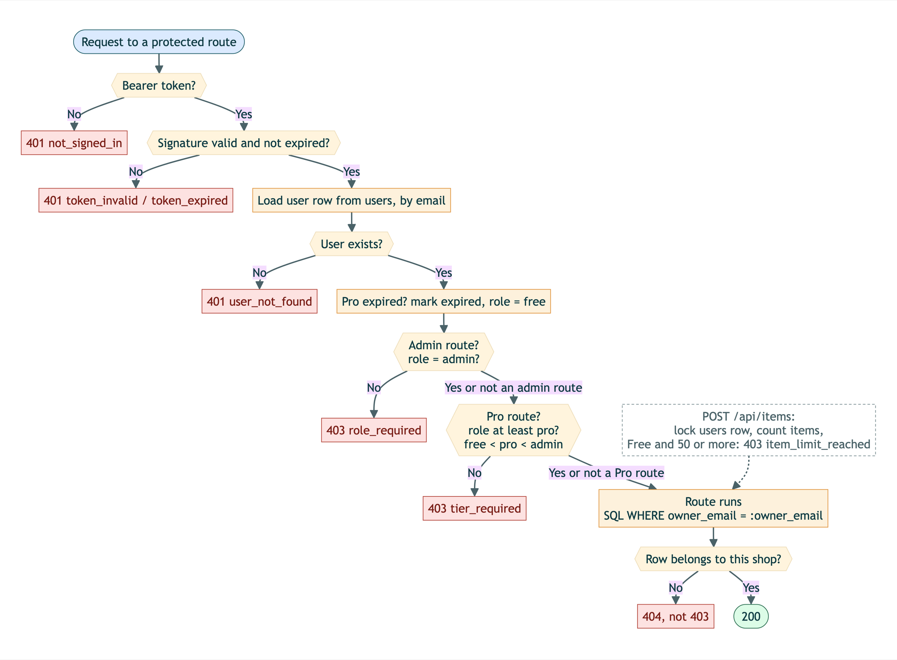

# 5. Security Design

LEBIS holds every shop's stock, customers' names and phone numbers, and its payment
history. This section describes how a user proves who they are, how passwords are
stored, how data is protected in transit and at rest, and how the server decides what
each role may do. Every rule below is enforced by the backend; the frontend only hides
buttons for convenience.

## 5.1 Authentication (JWT)

LEBIS uses signed JSON Web Tokens instead of server-side sessions.

1. The browser sends the email and password to `POST /api/auth/login`.
2. The backend loads the user row by email and checks the password with bcrypt
   (Section 5.2).
3. If either the email or the password is wrong, the answer is the same:
   **401** `invalid_credentials`. The response never tells an attacker which emails
   have an account.
4. On success the backend returns a token signed with **HS256** using `JWT_SECRET`.
   The token carries only the email (`sub`) and an expiry time (`exp`):
   **24 hours**, or **30 days** if the user ticks "Keep me signed in".
5. `lib/api.js` stores the token and attaches it to every later request as
   `Authorization: Bearer <token>`.

On every protected request, the dependency `get_current_user` checks the signature
and the expiry, then loads the user row from the database.

| Situation | Response |
|---|---|
| No token | **401** `not_signed_in` |
| Signature does not match, or the token was edited | **401** `token_invalid` |
| Token past its expiry time | **401** `token_expired` |
| Token valid, but the account no longer exists | **401** `user_not_found` |

**The role is read from the database on every request; it is not stored in the
token.** A shop that upgrades to Pro, cancels, or whose Pro period has ended gets the
right permissions on its very next request, without signing in again. Before the role
is used, `expire_pro_if_due` moves a Pro shop whose subscription has passed its end
date back to `free`.

When the frontend receives a 401 for a dead token, it removes the token and sends the
user to the sign-in page with a message, instead of retrying with the same token.

## 5.2 Password storage

- Passwords are hashed with **bcrypt** (`bcrypt.hashpw` with `bcrypt.gensalt()`).
  Each hash has its own random salt built in, so two users with the same password get
  different hashes.
- Only the hash is stored, in `users.password`. The plain password is never stored,
  logged or returned by any endpoint.
- Login compares with `bcrypt.checkpw`, which is deliberately slow and makes
  guessing passwords from a stolen database expensive.
- A password must be at least 8 characters. Anything longer than 72 bytes is rejected
  with `password_too_long`, because bcrypt ignores bytes after the 72nd and the user
  would otherwise believe the rest of the password protects them.
- Emails are trimmed and lower-cased on both sign-up and sign-in, so `Ann@shop.com`
  and `ann@shop.com` are the same account. Registering an email twice, even with two
  requests at the same moment, returns **409** `email_taken`.

## 5.3 Data protection

**In transit.** The frontend (Vercel) and the backend (Railway) are both served only
over HTTPS. The browser talks to a single origin: Next.js forwards `/api/*` to the
backend on the server side, so the backend address is never exposed and no CORS
rule is needed.

**Secrets.** `JWT_SECRET`, the database URL, the admin password and the LINE channel
keys live in environment variables. Locally they are in `.env`, which is listed in
`.gitignore`; the repository only contains `.env.example` with empty values. In
production they are set in the Railway and Vercel dashboards. Production uses a
different `JWT_SECRET` from local development, and the demo accounts that the
boilerplate seeds locally are switched off (`SEED_DEMO_ACCOUNTS=false`).

**Database.** The backend reaches PostgreSQL over Railway's private network, with
credentials held only in the backend's environment. Every query uses named parameters (`:owner_email`), never
string concatenation, so user input cannot change the SQL.

**One shop cannot see another shop's data.** Every query on items and rentals includes
`WHERE owner_email = :owner_email`, using the email from the verified token. A shop
that asks for another shop's item gets **404**, not 403 — a 403 would confirm that the
item exists.

**Other inputs that are checked:**

- LINE webhook calls must carry a valid `x-line-signature` (HMAC-SHA256 of the raw
  body with the channel secret), or they are rejected with 403.
- CSV exports prefix any cell that starts with `=`, `+`, `-`, `@`, a tab or a carriage
  return with `'`, so a customer name cannot run a formula when the file is opened in
  Excel.
- Request bodies are validated by Pydantic models. Invalid input, including numbers
  too large for the database, returns **422** instead of a server error.

## 5.4 Role-based access control

LEBIS has three roles, stored in `users.role` and ordered `free < pro < admin`.

| Can the role… | Free | Pro | Admin |
|---|---|---|---|
| Manage items and rentals | Yes, up to 50 items | Yes, no limit | Yes |
| See rental reports | Last 7 days | Full history | Full history |
| Export the report as CSV | No — **403** | Yes | Yes |
| Link LINE and receive reminders | No — **403** | Yes | Yes |
| Buy the Pro plan | Yes | No — **409** `already_pro` | No — **403** |
| Open the admin analytics dashboard | No — **403** | No — **403** | Yes |

Access is declared on each route as a FastAPI dependency, so the check runs before the
route's own code:

- `require_tier("pro")` — CSV export, and the LINE link code, test message and summary.
  A role below Pro gets **403** `tier_required`.
- `require_role("admin")` — `GET /api/admin/overview`. Any other role gets **403**
  `role_required`.
- The 50-item limit is checked inside `POST /api/items`. The route first locks the
  shop's row in `users`, then counts the shop's items, so several requests sent at the
  same moment cannot push a Free shop past 50. The 51st item returns **403**
  `item_limit_reached`.

Every case in the table above is checked against the live system by
`scripts/check-edge-cases.mjs` (Section 9.2).

## 5.5 Known limits

- There is no rate limit on sign-in attempts; bcrypt's cost makes each guess slow,
  but repeated guessing is not blocked.
- A token cannot be revoked before it expires. Signing out removes it from the
  browser only.
- There is no password reset by email (Section 2.3).
